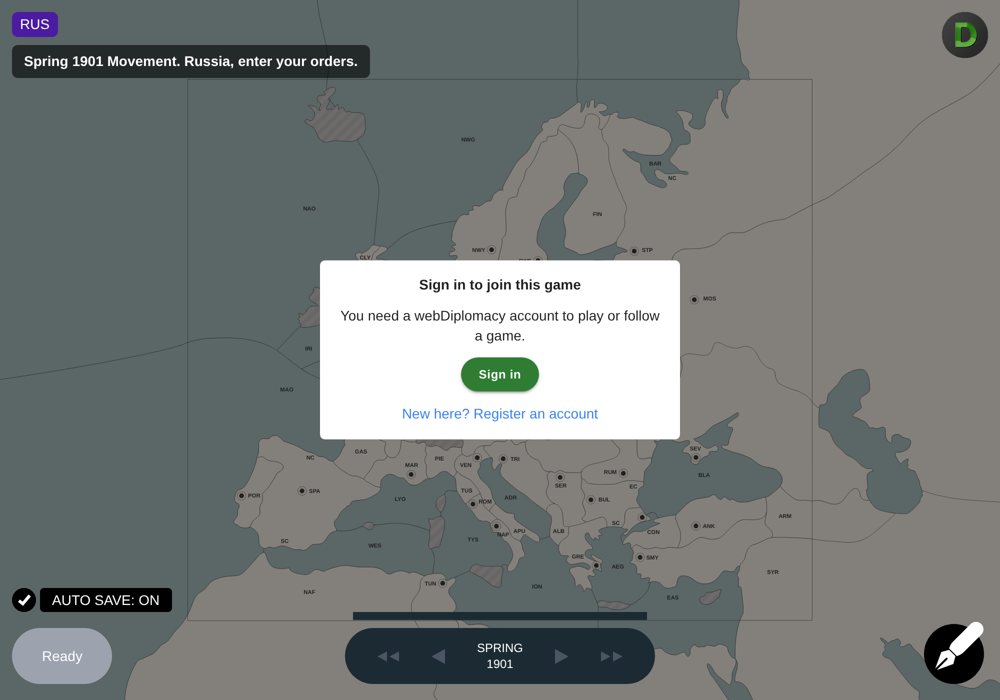
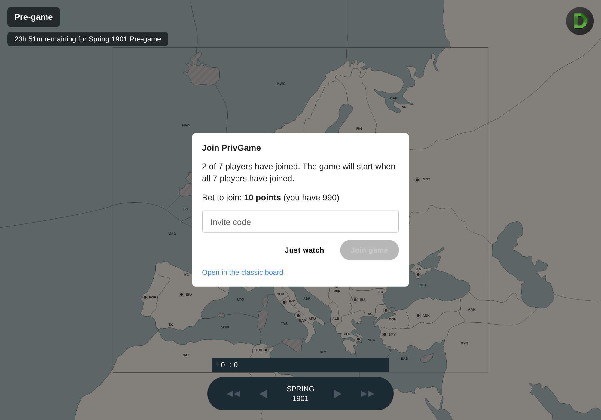
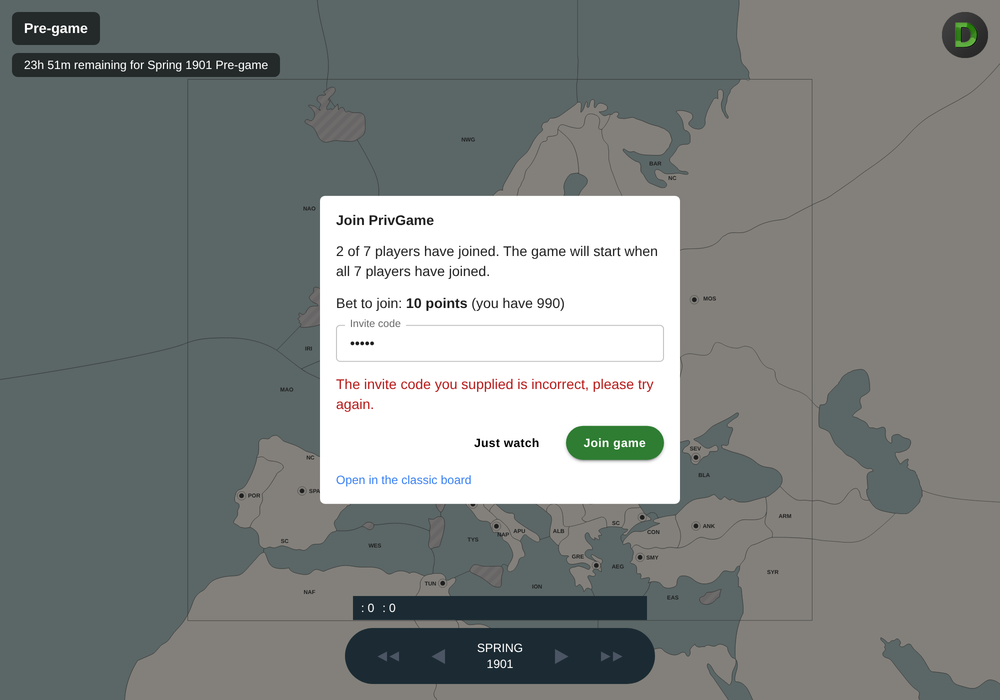
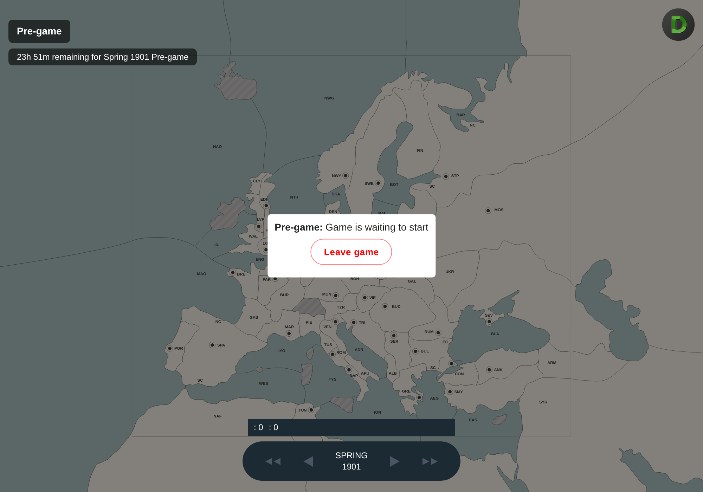

## Problem

A link to a game on the point and click board (`/game/?gameID=N`) gave anyone who wasn't in the game no way to join it. `board.php` sends classic-map users to `/game/`, and the only way to join was `board.php?gameID=N&view=dropDown`.

The board had no join UI, and the `game/join` API route it would need had never worked:
- It turned away non-members before running ("Access denied. User N is not member of associated game.").
- It never read the invite code or the country to take over (`gamepass` and `countryID` weren't in its argument list, and `isset(...) && ... ?? null` gave a boolean).
- `Members::join()` ends in `libHTML::notice()`. Under `IN_API` that prints text and `die()`s without a `COMMIT`, so even a successful join was rolled back. `game/leave` had the same problem.

## Changes

**Backend**
- `game/join` and `game/leave` now work, through the same `Members::join()` / `Member::leave()` code `board.php` uses, with the game locked for update.
  - `join()` and `leave()` take `$redirect = false` so the route can commit, rewrite the game's public files and return JSON. `board.php` uses the default and is unchanged.
  - A browser session must send the one-use form ticket `board.php`'s form uses (`libHTML::checkTicket()`). API keys don't need one.
  - A refused join is a 403 whose text is the reason (wrong invite code, too few points, game full, banned, and so on).
- New `game/joininfo` route: what `joinBar()` works out for `board.php`. That is whether the viewer can join and if not why, the bet, whether an invite code is needed, the countries in civil disorder that can be taken over, and the form ticket.
- `logon.php?returnTo=` sends a visitor back to the page they came from once logged on. It only accepts relative paths on this site.

**Board (`game-src`)**
- `WDJoinPanel` for anyone viewing a game they aren't in. It shows the bet and how many players have joined, an invite-code field for a private game, and a country picker once the game has started. It also has "Just watch" and a link to the classic board.
  - It replaces the "waiting to start" overlay for non-members.
  - After a successful join the page reloads onto the player's board.
  - Logged-out visitors get a sign-in prompt that returns them to the same game.
- `WDLeaveGameButton`: players in a game that hasn't started get "Leave game" on the waiting screen. It asks for confirmation, refunds the bet and goes to the home page, as the classic board does.
- The TODO in `WDInfoDisplay.tsx` is resolved: the game title links to `board.php?gameID=N` instead of the legacy join bar.

## Screenshots

| Signed out | Private game |
|---|---|
|  |  |

| Wrong invite code | Leave before the game starts |
|---|---|
|  |  |

## Testing

- **Before the fix:** `POST api.php?route=game/join` as a non-member returned 403 "Access denied … not member of associated game".
- **Local server** (PHP 8.3, MariaDB with `fullInstall.sql`, Redis, real logins):
  - `game/joininfo` returned the expected data.
  - Join with no ticket, or a reused ticket, was refused with "This form has expired…".
  - A wrong invite code was refused with the readable message.
  - The right code joined: the member row was saved, the bet was deducted, and the public `game.json` listed the new player.
  - `game/leave` refunded the bet and the player dropped out of `game.json`.
  - Too few points was refused with a plain-text reason.
  - Logged-out requests got a 401.
- **Legacy flow:** the `board.php` join form still joins and redirects as before.
- **`logon.php?returnTo=game/?gameID=2`:** after logging on it redirects to the game, and `//evil.example` is ignored.
- **Board unit tests:** 10 new tests in `WDJoinPanel.test.tsx` and `WDLeaveGameButton.test.tsx`; all 11 tests pass. `npm run build` passes, and the new files lint clean.
- **Chromium (Playwright) against the local server:** sign-in prompt; join panel; wrong code; join, then the reload onto the member view; leave, then the home page with the join panel shown again. No board JavaScript errors.

**Not tested end to end:** taking over a country in civil disorder in a game that has started. It is covered by a component test, and it uses the same `join()` path as `board.php`.

**Already like this before the change:** a logged-out visitor's game never loads, so the placeholder board ("Russia, enter your orders") shows behind the sign-in prompt.

🤖 Generated with [Claude Code](https://claude.com/claude-code)

https://claude.ai/code/session_01NRucw8BVFbA2NHNMWFgJRz
